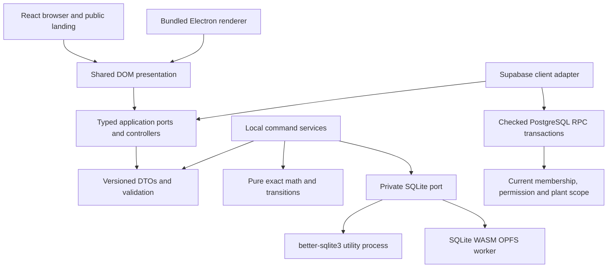
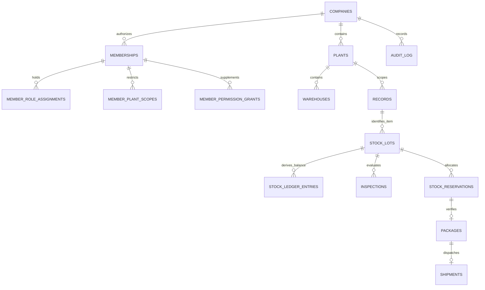

# Architecture

## Repository and dependency direction

Active apps: `apps/desktop` and `apps/web`. Deferred drafts: `apps/mobile`, `packages/sqlite-mobile`, and `packages/ui-native`. Shared packages contain contracts, pure domain rules, application ports/controllers, DOM presentation, semantic tokens, cloud/local repositories, private SQLite adapters/schema, encrypted backup envelopes and SAMPLE fixtures.

Domain imports no UI, Auth SDK, network, filesystem or database drivers. Presentation imports no privileged SQLite/Node modules. Cloud business DTOs remain separate from generated database row types.

## Electron runtime

The main process owns windows, protocols, OS dialogs, OS-backed credential encryption and the database utility lifecycle. It serves only bundled local assets through a secure custom protocol. Renderer Node integration is off; context isolation, sandboxing, CSP, navigation restrictions and sender/frame validation remain on.

Preload exposes individual typed methods for workspace list/create, snapshot, command execution, encrypted database export and a bounded credential namespace. It exposes no arbitrary SQL, path, shell or generic IPC sender. Preload is bundled separately so Node-only process bootstrap code cannot enter the sandbox.

The utility process owns SQLite and a serialized command queue. Each local command uses one real transaction containing domain changes, signed ledger, genealogy, audit and idempotency result. It does not hold transactions across prompts, network calls or file dialogs. The application uses user-data storage, not installation directories, and a single-instance lock. Browser storage holds a Web Lock and OPFS SAH pool in a dedicated worker; unsupported persistence fails explicitly.

## Authority and backend

`Authority` distinguishes `{kind:'solo', workspaceId}` from `{kind:'team', companyId, plantId?}`. The discriminator appears in requests and query keys. Solo provenance does not create Auth identities or independent approval credentials. Cloud cache scope includes identity and authority; switching scopes cancels reads and clears old results.

Supabase uses one isolated project per environment. Public tables have RLS and intentional read grants. Business mutations use public SECURITY INVOKER RPC facades over narrowly checked non-exposed helpers. Helpers derive `auth.uid()`, require current membership/permission/scope, use fixed search paths, and reject archived-company writes. Authorization never uses editable user metadata.

Initial team commands serialize per company/plant with transaction-scoped advisory locks. This conservative first-slice choice prevents overselling; finer row locking/indexed read models belong to measured scaling work. API commands, ledger and audit commit together. Authenticated clients receive no service-role credentials.

## Data model

The initial schema uses validated typed JSON fields for commercial/master drafts alongside normalized stock, reservation, inspection, package, shipment, genealogy, audit and request-result records. This representation is explicit and is not a claim that the complete normalized BOM/job-card/document model already exists.

Composite relationships prevent cross-company/plant references. Local schema uses equivalent business concepts with a workspace UUID and owner provenance. Local decimal TEXT and PostgreSQL NUMERIC remain exact through shared string DTOs. Ledger/audit modification triggers and approved-engineering immutability protect history.

## Dependency and release policy

The active pinned matrix includes React 19.2.3, Vite 8.3.4, TypeScript 6.0.3, Electron 44.7.0, better-sqlite3 13.0.3, SQLite WASM 3.53.4-build2, Supabase JS 2.117.3 and CLI 2.120.0. TypeScript 6 was selected after checking ESLint's supported peer range; latest alone is not compatibility proof. Exact manifests and the single pnpm lockfile are the reproducible source of truth.

Windows NSIS packaging includes bundled assets and native dependencies. Installed/clean-machine proof, signing and update feed activation are separate gates. Desktop software must not need development Node.js or a database server for solo operation. Production hosting and backend restore remain owner-controlled operations.

## Pending confirmations and plant selection

The composition roots supply the `PendingCommandStore` port through the reusable client-storage adapter. Each command is retained before sending, scoped by trusted current account and explicit authority/plant. A definitive response removes it; loss of confirmation restores the original key after restart. Invalid/unavailable journal storage blocks dispatch. The journal contains one pending request, not queued offline business writes or automatic synchronization. Browser/desktop web storage contains these business request fields; it does not contain privileged backend credentials.

Team workspace opening resolves an authorized plant before enabling commands. The persistent plant selector lists current scope only. Switching plant/company clears previous queries; pending confirmations block switching. SQL RLS and command checks remain the final authority. Read/result/admin DTOs are validated at the client boundary. Revision integers use exact BigInt/string conversion and reject unsafe numbers; local mutation guards prevent 64-bit sequence overflow.

## Operational references without commercial access

The team snapshot includes two bounded obligation projections authorized by current stock/dispatch permissions. Each exposes exactly identifier, code, item identifier, original quantity and state. A Stores member can choose an accepted order or approved PO and perform its permitted reservation/receipt while full quote, sales-order, purchase-order, price and customer fields remain protected by ordinary RLS. A narrowly checked private read helper supplies these references; it does not grant business-table mutation or broaden commercial read policy. Shared application helpers supply selectors and dispatch labels consistently.

## Desktop recovery selection

Typed application recovery ports expose individual preview/activate/cancel preload operations. Main owns bounded file selection and authenticated decryption. Utility SQLite validates the allowlisted schema and supported obligations in query-only memory, writes and revalidates a separate managed database, then atomically commits its versioned selector. Previous bytes remain intact. Startup rejects invalid selectors without fallback. The selector and durable client journal retain activation tokens for restart confirmation. See [docs/recovery.md](docs/recovery.md).

## Concurrent team command authority

Business RPCs acquire shared company/current-actor membership locks, then the existing plant stock lock. The checked delegate revalidates current permissions, plant, company state and MFA while those rows remain protected through commit. Metadata changes either commit before authorization and are observed, or wait for the already authorized command. The unlocked private delegate has no client execution grant. Public signatures are unchanged. This proves the current stock command slice; wider administration and production contention remain pending.

## Local startup compatibility

The owning local schema service enables connection foreign keys, then reads metadata/version within a serialized transaction before any DDL. Existing databases require the supported explicit object names/types and exactly one supported version/checksum row. Missing history objects, unversioned existing tables, unexpected objects or unknown versions fail without repair. Empty schema plus its version commit atomically. This does not perform a version upgrade or authorize destructive downgrade.

## Database engines and company setup recovery

Solo desktop records use device-local SQLite in the Electron database utility process. Team records use the PostgreSQL database supplied by Supabase, together with Supabase Auth and protected RPC/RLS interfaces. PostgreSQL is the database engine inside the selected Supabase backend, not an additional application backend. Development database assertions run against the isolated local Supabase stack; they do not move solo records online. See [Supabase database overview](https://supabase.com/docs/guides/database/overview).

Company creation has its own strict versioned contract and application controller because no company authority exists yet. The platform supplies an account-and-backend-origin-scoped journal and an exclusive device writer lock. Input and request key are retained before dispatch. The cloud adapter verifies and pins the account token for the RPC, validates the returned company UUID, and reuses the existing atomic PostgreSQL creation/replay transaction. Another account/backend cannot load that journal through its configured adapter. No credentials or invitation tokens are stored there.

An initial recognized rollback may clear its request. An uncertain attempt remains retained even if a subsequent retry is denied. Committed confirmation and local journal cleanup have separate results, and failed list refresh does not undo a commit. Invitation, member/plant and ownership transport recovery remain separate pending slices.

## Administration request recovery

The shared administration controller covers invitation creation, member access and plant/warehouse creation using strict versioned contracts. Company setup and administration reuse the same owning journal implementation, writer locks, verified-token helper and durable confirmation handling. Their namespaces remain separate; administration retains one account/backend-scoped request including its original company and operation. No returned invitation token is persisted in that journal.

The Supabase adapter translates the closed operation union to existing checked RPCs and validates their response shapes: an invitation identifier/token, a plant UUID, or an intentional null/void member-update response. It pins the verified original account token. Current company permission, delegation and plant scope are enforced by the server. Recognized initial rollback responses may clear a journal; subsequent rejection cannot clear an earlier unknown outcome.

The shell owns recovery outside tenant-dependent rendering. It loads the journal on Team account selection and exposes original retry at the company picker and above unavailable tenant reads. Pending, active or corrupt administration blocks new writes and scope changes in the current Team session. Account switching removes displayed confirmation/token state while preserving the original account journal. Read refresh and local cleanup failures are separate from a confirmed commit. Wider server administration contention and ownership/policy transport recovery remain pending.
